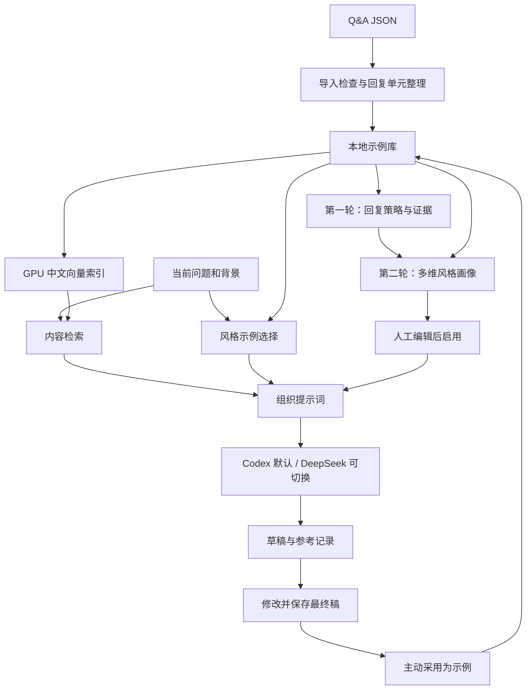

# 个人回复助手：详细开发计划

版本：v1.1  
日期：2026-10-08  
状态：开发规划，尚未实施  
默认模型入口：本机 Codex CLI，GPT-6 Luna  
可切换入口：DeepSeek 官方 API

本次修订：参考 `E:/auto_writing_convert` 的两轮风格分析流程；向量编码与相似度计算改为 NVIDIA GPU / CUDA 优先，禁止静默回退到 CPU。

## 1. 项目目标与已确定需求

开发一个独立的个人回复助手，导入已经整理的小红书 Q&A，通过检索历史内容、选择风格示例和注入可编辑的风格规则，生成适合当前问题的回复草稿。

用户已确定的要求：

1. 主要模仿回复的语气和表达习惯。
2. 问题和适用条件相似时，可以复用历史观点、方法和知识。
3. 历史材料未覆盖的内容，允许模型根据当前问题自行补充。
4. 使用现有小红书采集工作台生成的 Q&A，作为第一批数据。
5. 作为独立项目开发，通过文件导入与采集工作台衔接。
6. 不微调大模型，不训练风格模型；本机承担数据管理和轻量检索。
7. **Codex 为初始默认入口，使用 gpt-6-luna；DeepSeek 为用户主动选择的备选入口。**
8. 风格画像参考本机 auto_writing_convert 的实际实现，适配短回复和多轮 Q&A。
9. 本机已有 NVIDIA GPU；能由 GPU 执行的向量模型计算使用 CUDA，CPU 不作为默认推理设备。

第一版使用方式按本地网页规划：输入问题及背景 → 生成草稿 → 查看参考 → 修改 → 复制或保存。自动发送到社交平台、批量处理、多人使用暂留后续版本。

本文件存放于现有采集项目中，作为后续独立项目的开发依据。建议新项目目录为 `E:/关于我和你/个人回复助手`，具体目录在创建时确定；本次仅编写计划。

## 2. 现有数据基线

### 2.1 已核实的数据

核对日期为 2026-10-08，当前结构化合集位于：

`E:/关于我和你/小红书爬虫/data/qa/603923a9-0ba9-474e-a5be-b3007fa6bc89.json`

| 类别 | 分组数 | 目标评论数 | 首版处理方式 |
| --- | ---: | ---: | --- |
| qa：已整理问答 | 63 | 95 | 经过结构与内容检查后进入候选示例库 |
| standalone：独立评论 | 3 | 3 | 按适用性作为感谢、祝福等风格示例 |
| unresolved：待整理 | 13 | 52 | 保留原文，整理并验证后再启用 |
| 合计 | 79 | 150 | 保留导入清单和处理状态 |

其他已核实情况：

- 150 条目标评论按笔记 ID 与评论 ID 去重后仍为 150 条。
- 95 条已整理问答中的目标评论，有 1 条正文为空。
- 63 组问答中，20 组包含多条目标回复。
- 数据中存在自问自答、连续补充、他人追问和仅用于补足语境的前文。
- 合集状态为 partial；covered_count 为 150 代表目标评论已经收录，不能据此认定语义整理全部完成。
- 单条已整理目标评论长度中位数约为 154 个字符；同组目标评论合计最长接近 1,000 个字符。长度统计用于初始设计，不作为生成回复的硬限制。

上述数量是本次文件快照的基线。未来导入新文件时重新统计，不把这些数字写死在应用逻辑中。

### 2.2 对设计的直接影响

1. 原始 JSON 作为优先导入格式，保留字段与回复关系。
2. 检索单位应当是完整的回复单元，不能按单条评论或固定字符数机械切分。
3. 对方的提问和表达仅提供背景，不能被当作目标作者的风格。
4. target=true 只表示作者身份；自问自答中的问题仍需识别为问题。
5. context_only=true 的目标评论保留作上下文，不重复计为该单元的新回答。
6. unresolved 和空正文均不能无提示地进入可用示例库。
7. 原文、用于检索的派生文本、人工修改稿分别保存，保证可以回到原始材料核对。

### 2.3 初步风格观察

从代表性样本中观察到以下表达习惯，作为风格画像初稿，不视为每次回复必须满足的模板：

- 使用亲昵称呼，根据对象和语境调整亲近程度。
- 先回应情绪、肯定观察，再分析原因或提出方法。
- 用编号、分段和【关键词】组织较复杂的建议。
- 通过具体例子、比喻说明抽象方法。
- 适量使用表情、语气词和祝福式收尾。
- 信息不足时会进一步询问年级、科目或具体困难。

历史材料中的学校、成绩、个人经历、特定昵称，以及以后发布合集、提醒某人的承诺，不直接归入可随意套用的风格规则。

## 3. 第一版范围与产品流程

### 3.1 第一版必须交付

- 现有 Q&A JSON 的导入、预览、去重和问题提示。
- Q&A 原文查看，示例编辑、启用与停用。
- 待整理分组的人工整理，以及受约束的模型辅助分组。
- 可编辑、带示例依据、可保存版本的风格画像。
- 内容检索与风格示例选择。
- Codex 默认生成，以及 DeepSeek 手动切换。
- 草稿生成、取消、重新生成、编辑和复制。
- 每次生成的参考记录和最终采用稿。
- 手动将认可的最终稿加入示例库。
- 资料、风格配置和最终稿的备份与导出。

### 3.2 后续扩展

- 通用 CSV 导入与列映射、Markdown 导入。
- 批量问题导入与逐条审核。
- 多个风格档案、不同回复对象的预设。
- 平台接口、自动发布、远程访问、多人账号。
- 自动联网查资料、复杂重排模型、独立向量数据库。

首版优先完成现有 JSON 的完整流程。当前采集工具导出的 CSV 带有公式转义，Markdown 带有原文围栏；以后增加适配时分别处理，不用同一套通用文本切分替代结构解析。

### 3.3 主要操作流程

首次使用：

1. 启动本地服务，检查 Codex 是否可调用。
2. 选择 Q&A JSON，查看导入预览。
3. 确认目标作者、可用数量、待整理数量和排除原因。
4. 检查 CUDA 推理环境，在 GPU 上建立索引，通过两轮分析生成风格画像初稿。
5. 编辑风格画像并保存为启用版本。
6. 输入一个问题，完成生成、修改和复制。

日常使用：

1. 输入问题，可附加对方背景、前文和希望的长度。
2. 使用当前模型入口生成草稿；首次启动和未保存偏好时默认 Codex。
3. 在草稿旁展开参考资料，查看哪些历史回答被作为内容或风格参考。
4. 修改草稿并保存最终稿。
5. 需要累积示例时，主动点击“采用为示例”。

保存最终稿与采用为示例是两个独立动作，原始生成稿不会自动进入示例库。

## 4. 技术架构与项目组织

### 4.1 技术选择

| 部分 | 首版选择 | 目的 |
| --- | --- | --- |
| 运行环境 | Windows、Python 3.11、独立虚拟环境 | 与当前使用环境衔接，隔离依赖 |
| 后端 | FastAPI、Pydantic | 文件导入、检索、模型调用和任务状态 |
| 页面 | Jinja2、原生 JavaScript、CSS | 四个页面入口，保持构建和部署简单 |
| 持久化 | SQLite | 存储示例、风格、任务、反馈和设置 |
| 语义检索 | 预训练中文向量模型，NVIDIA GPU / CUDA 推理 | 处理同义表述，不需要训练 |
| 向量模型候选 | BAAI/bge-small-zh-v1.5 | 作为首轮评测基线，实测后固定版本 |
| 向量计算 | PyTorch CUDA 张量、归一化向量相似度 | 编码与相似度计算均使用 GPU，无需单独服务 |
| 关键词检索 | 中文字词特征与 BM25 | 补充科目、术语和明确关键词匹配 |
| 模型入口 | Codex CLI 默认；DeepSeek API 可切换 | 同一份检索材料和风格约束适配两种入口 |
| 任务执行 | 单进程、SQLite 任务记录、异步执行 | 首版串行模型任务，支持取消与恢复状态 |

在独立环境安装支持 CUDA 的 PyTorch 和 Sentence Transformers，默认设备显式设为 cuda:0。向量模型首次下载后缓存在本机，支持指定已有模型目录。记录模型名称、revision、维度、预处理版本和精度策略；更换其中任何一项时重建并版本化索引。

Codex 和 DeepSeek 的生成均使用在线模型。本机 GPU 承担向量编码和相似度计算；分词、关键词统计、数据库及文件操作继续使用 CPU，不在本机训练或部署生成式大模型。

本次通过 nvidia-smi 只读核实：NVIDIA GeForce RTX 4060 Laptop GPU，显存 8,188 MiB，驱动 581.08，驱动报告 CUDA Version 13.0。该版本信息不等同于独立项目的 PyTorch CUDA 运行时已验证。P0 按驱动与 Python 的兼容情况选择官方 CUDA 构建，锁定实际验证通过的版本；本次不安装或更换驱动及依赖。

### 4.2 数据流



### 4.3 建议目录

```text
个人回复助手/
  app/
    main.py                 # 启动、路由与生命周期
    config.py               # 默认设置和配置校验
    db.py                   # SQLite、事务和版本迁移
    schemas.py              # 请求、响应、任务与示例结构
    importers/xhs_qa.py      # 当前 Q&A JSON 适配
    examples.py             # 回复单元、版本、审核与启停
    retrieval.py            # 关键词、向量检索与示例选择
    style.py                # 两轮画像、证据校验、提示词编译与版本
    generation.py           # 提示词组织、生成和反馈流程
    jobs.py                 # 状态、取消和重启恢复
    providers/
      base.py               # 两种入口的共同协议
      codex.py              # Codex 子进程适配
      deepseek.py           # DeepSeek HTTP 适配
    prompts/                # 回复策略分析、风格画像、生成提示词及输出定义
    templates/              # 页面模板
    static/                 # CSS、JavaScript
  tests/                    # 合成数据和行为测试
  scripts/                  # 安装、启动、索引与评测入口
  docs/                     # 计划、数据说明、操作说明
  data/                     # 本地资料、SQLite、索引、备份
  exports/                  # 用户主动导出的资料与最终稿
  pyproject.toml
  requirements.lock
  README.md
```

目录是职责划分建议，具体文件随实现规模调整。首版一个服务进程即可，无需微服务或独立任务中间件。

## 5. 数据导入与示例整理

### 5.1 导入协议

首版接受现有 QAService 保存的 JSON。至少校验：

- 合集元数据：id、status、nickname、user_id、groups。
- 分组字段：kind、messages、warnings。
- 消息字段：note_id、comment_id、content、target、context_only，以及父评论和来源信息。
- types、数组结构、字段长度和文件体积；上传文件大小初始上限设为 10 MiB，可配置。
- 不认识的字段可以保留在原始快照；未知分组类型进入待检查状态，不能静默当作问答。

两步导入：先预览，再确认入库。预览返回可用、待整理、排除、重复和冲突数量；确认使用同一份文件快照及其哈希，防止预览与入库内容不同。

### 5.2 原文与派生字段

每个回复单元包含：

| 字段 | 含义 |
| --- | --- |
| id、version | 本地稳定标识和版本 |
| source_type、source_refs | 来源类型，以及笔记、评论、导入批次等引用 |
| source_thread_key | 原始会话链标识，用于去重、示例多样性和评测隔离 |
| original_messages | 原始消息及角色标记，逐字保留 |
| question_text | 当前单元实际回答的问题，不混入后续追问 |
| context_text | 理解问题所必需的此前语境 |
| answer_text | 当前单元完整回答，可包含连续目标评论 |
| topic_tags、scene_tags | 主题和回复场景标签，允许为空或人工修正 |
| status、review_reasons | ready、needs_review、excluded，以及对应原因 |
| content_enabled、style_enabled | 是否参与内容检索、是否作为风格示例 |
| content_hash | 用于识别内容变化和索引失效 |
| origin | imported 或 user_approved，用于区分历史导入与主动采用的稿件 |

原文不因清洗或编辑被覆盖。移除称呼、替换平台表情、合并连续回复等操作仅作用于派生字段。

### 5.3 多轮与自问自答

1. 先按原始父子关系和时间恢复局部对话，保留完整分组作为来源。
2. 连续且回答同一问题的目标评论可以组成一个 answer_text。
3. 中间出现新的问题时，建立新的回复单元，并带入必要前文。
4. 多人旁支根据被回复关系区分；关系不清时进入 needs_review。
5. 对自问自答，把提出问题的目标评论标为 question，把实际解释部分标为 answer。
6. 纯表情、空正文、缺少必要父评论或只能依靠缺失图片理解的材料，标记原因后排除或待审。
7. 同一目标评论可作为其他单元的上下文，但不能重复计为多个独立答案的核心内容。

结构规则能够确定的单元直接处理；语义含糊时使用受约束的模型辅助标注或人工修正。辅助模型仅返回消息 ID、角色和划分，不重写历史原文。新项目自行校验 ID 合法性、父子顺序、覆盖情况和跨会话边界。

### 5.4 重复导入与冲突

- 相同文件哈希重复导入，返回已有批次及统计。
- 跨文件的原始评论按来源、笔记 ID、评论 ID 识别。
- 回复单元使用目标作者与核心消息 ID 集合构成来源指纹，不以文件名或临时编号作为唯一身份。
- 内容和结构完全相同时复用已有单元，补充来源批次。
- 同一来源的正文或回复关系不同，建立待审版本，保留当前启用版本，不自动覆盖。
- 分组变化导致核心消息部分重叠时提示合并或替换，避免两份近似答案同时放大检索权重。
- 导入默认追加；不会因为新文件没有出现旧样本就删除旧样本。

### 5.5 当前待整理材料

13 组 unresolved 全部保存，初始关闭内容和风格用途。提供两种整理方式：

- 人工选择问题、上下文、答案并确认。
- 用户点击模型辅助整理，默认调用 Codex，校验通过后展示划分结果供确认。

整理失败或取消时保留原状态和原文。其他已可用的问答可以继续参与生成。

## 6. 风格画像

### 6.1 参考项目与适配原则

已查看本机 `E:/auto_writing_convert` 当前工作区中的 style_factory/distill.py、相关技术规格，以及 persona-template.md 和 7-dimensions-framework.md。以实际代码为主要实现依据：

| 参考项目的现有设计 | 本项目的适配 |
| --- | --- |
| 第一轮分析思维习惯、论证与立场，保存 thinking.md | 第一轮提取回复策略、情绪回应、澄清习惯及有条件的观点，保存材料分析摘要 |
| 第二轮结合第一轮与原文，分析表达并交叉验证 | 第二轮同时读取策略结果和完整代表性 Q&A，生成可编辑风格画像 |
| 词汇、句法、语气、篇章、修辞、情感、视角及格式适配 | 转换为短回复与多轮问答的 7+1 个分析维度 |
| 提示词含核心规则、参考卡、特色表达、禁用清单和双重复检 | 形成回复规则、场景卡、避免事项及正文生成前的两项检查 |
| 输出 prompt.txt、SKILL.md 和分析稿 | 首版输出结构化画像、可读风格卡、可复制提示词及两轮分析摘要；SKILL.md 安装包留待需要时增加 |

“两轮分析”指两次顺序模型调用，不涉及参数训练。两轮默认均使用 Codex · GPT-6 Luna；用户可在任务开始前选择 DeepSeek，入口在整个任务内保持一致。

主要目标仍是模仿语气。参考项目中对世界观、身份认同的全面推断不直接用于本项目；提取的观点带主题、适用条件和来源，只在相近问题中作为内容候选，不成为全局强制立场。用户本次明确要求和手工规则优先于从样本推断的倾向。

### 6.2 语料准备与可复核统计

1. 从 ready 且 style_enabled 的目标回答中取样；提问和前文只作为理解场景的背景，不参与作者用语统计。
2. 按原始会话去重，覆盖方法解释、情绪回应、追问、讨论、感谢等场景及不同长度。
3. 每个样本保留稳定 ID、问题、必要前文和完整答案。长材料按完整回复单元分批，不照搬“只取文章前 1,500 字”的处理方式。
4. 由本地代码统计回答长度、段落数、句长分布、称呼、标点、表情、编号与【关键词】出现情况，记录统计口径和样本数。
5. 语气、修辞及回复策略由模型归纳，并引用具体示例；模型判断与程序统计分别标注，不能让模型虚构精确频率。
6. 对于需要通用语料作对照的“显著高频词”等指标，首版没有对照数据时仅报告本库频率，不声称显著高于其他作者。
7. 数据不足的场景标记缺口，保留观察，不为凑足维度或规则数量编造结论。最终评测留出会话在取样前排除。

### 6.3 第一轮：回复策略与内容边界

输入为样本清单、原文 Q&A、基础统计和用户明确偏好。输出可供用户阅读的材料分析结果：

- 回应顺序：先确认情绪、先给结论、先追问，或先解释原因。
- 建议形成方式：如何拆问题、举例、给行动步骤和判断适用条件。
- 互动习惯：怎样称呼对方、表达支持、回应追问或结束对话。
- 内容候选：反复出现的方法与观点，每条保留适用主题、条件和原文来源。
- 相反或不一致的案例，以及可能的场景差异；不强行合并成唯一性格。
- 需要排除或单独确认的个人经历、身份和未来承诺。

每条观察包含 evidence_ids 和适用场景。这里只提炼文本中可观察到的回复行为，不猜测作者未表达的人格、身份或经历。

第一轮通过 schema 和来源 ID 校验后保存检查点。第二轮失败时可以从相同输入快照和第一轮结果继续，不必重复消耗第一轮调用；语料、模型、提示词或用户要求变化时开始新版本。

### 6.4 第二轮：7+1 维表达分析与规则编译

第二轮同时接收第一轮结果、统计和原始代表样本，防止只根据前一轮摘要继续放大误读。

| 维度 | Q&A 中的具体观察对象 |
| --- | --- |
| 词汇 | 称呼、语气词、惯用短语、口语与书面语比例倾向 |
| 句法 | 长短句、疑问与建议句、重复强调和停顿方式 |
| 语气 | 亲近程度、直接程度、建议的确定性与缓和方式 |
| 回复结构 | 开头、情绪回应、分析、步骤、例子与收尾的顺序 |
| 修辞 | 比喻、对比、具体例子、类比与解释方式 |
| 情感态度 | 鼓励、共情、纠正、认可及情绪强度的场景差异 |
| 交流视角 | 我、你、我们等人称用法，与对方的互动位置 |
| 格式适配 | 短答、长答、连续补充、澄清追问时的分段、编号和表情使用 |

从有证据的观察中形成最多 5—8 条核心回复规则，以及场景相关的可选规则。证据不足时减少数量，不强行达到下限。较有辨识度的综合特征，要求至少两个维度支持；适用场景不同的矛盾特征分别保留。

每条规则的结构包括：rule_id、dimension、description、applicable_scenes、evidence_ids、counterexample_ids、strength、origin、enabled。strength 使用“核心倾向、场景倾向、待核实”等定性标签，不伪造置信概率；origin 区分 observed 与 user_defined。

反例优先引用真实相反样本；为解释规则临时编写的反例必须标为合成演示，不能伪装成作者原文。某种写法没有出现，仅表示未观察到；只有明确用户要求或充分依据，才进入强制避免清单。

### 6.5 产物、交叉校验与两项生成检查

画像版本包含以下产物，均关联 corpus_hash、样本 ID、模型、提示词版本和生成时间：

| 产物 | 用途 |
| --- | --- |
| profile.json | 结构化画像、规则、证据、适用场景与版本元数据 |
| style-card.md | 面向用户的风格卡，展示倾向、依据、反例和缺口 |
| prompt.txt | 从已启用规则编译的可直接使用的精简提示词 |
| analysis/reply-strategy.md | 第一轮的材料分析摘要和来源 |
| analysis/expression.md | 第二轮的表达分析、交叉校验与未决问题 |

SQLite 中的画像版本为应用权威记录，上述文件为可重新生成的版本产物与导出内容；手工编辑通过页面写回版本，再统一编译，避免多份文件互相覆盖。

两轮均使用结构化输出，不沿用参考项目的文本分隔符解析。应用验证引用 ID、摘录与原文的一致性、统计口径和规则适用范围；发现缺失依据、重复规则或未解释的矛盾时返回待修正项。所有必要产物通过检查后才形成可启用版本，失败的半份结果保留为任务检查点，不替换当前画像。

日常回复生成在同一次请求内进行两项检查：

1. 表达检查：称呼、节奏、结构和表情是否符合所选场景，是否出现机械套话。
2. 内容检查：使用的历史观点是否适用于当前条件，是否夹带历史身份、错误称呼或未来承诺。

两项检查不要求额外模型调用，也不要求输出模型内部推理；用户只看到草稿及必要的简短审核提示。

### 6.6 编辑、启用与增量更新

- 页面展示风格卡、规则文本、统计和原文依据，不要求用户编辑 JSON。
- 允许修改、删除、停用某条规则，并添加明确偏好；用户规则不必伪造来源证据。
- 每次保存产生新版本；生成任务固定使用开始时的版本。
- 新增资料后仅提示画像可能需要更新，不自动覆盖用户已编辑的画像。
- 用户主动刷新时展示新增、修改、冲突和保留规则，保留手工修改并由用户选择启用版本。
- 全部参考样本已被停用的自动规则标为需要复核，不继续静默使用。
- 两轮之间展示“回复策略分析 1/2”“风格画像生成 2/2”的进度，不插入必答问卷；生成初稿后统一编辑和启用。
- 用户当前明确要求优先，例如这一次不要亲昵称呼或不要表情。

### 6.7 风格与个人事实分开

“温和解释”“先安慰再建议”属于风格。“我在某学校读书”“我以前考过某个分数”属于个人事实。首版允许用户填写明确确认的个人背景；未确认的历史经历不得自动改写成当前说话者的第一人称经历。

## 7. 检索与示例选择

### 7.1 内容检索

索引以 question_text 和必要的 context_text 为主；answer_text 保持完整，用于找到问题后提供对应观点和方法。

初始流程：

1. 对当前问题和用户提供的背景进行轻量规范化。
2. 关键词与向量各召回最多 10 个候选，按排名融合，避免直接相加不同尺度的分数。
3. 按主题、适用条件和会话来源去重，选择最多 3 个内容候选。
4. 保留关键条件，如年级、科目、问题类型；条件明显冲突的候选降权或排除。
5. 将候选作为待判断适用性的参考提供给模型，由模型说明实际采用了哪些材料。

召回分数表示匹配程度，不是观点正确率或适用概率。阈值和候选数量通过本地检索样例调整，不预设任意相似度数值为可靠判据。

### 7.2 风格示例选择

选择最多 3 个风格示例，优先匹配回复场景、期望长度和表达结构，再考虑主题。场景初始划分为：方法解释、情绪回应、澄清追问、观点讨论、感谢祝福。

示例选择遵循：

- 只使用 style_enabled 的目标回答。
- 尽量来自不同原始会话，避免反复套同一开头。
- 内容参考已经包含的示例不重复塞入提示词，可同时标注两种用途。
- 信息不足时可以由用户指定回复场景；默认自动判断在同一次生成请求中完成，不额外增加分类模型调用。
- 当前问题很短时仍保留少量通用代表示例，避免完全失去个人语气。

### 7.3 中文与长文本

向量模型显式加载到 cuda:0，资料批量编码、增量编码和查询编码都使用 GPU。使用模型官方推荐的编码方式，统一归一化，明确查询文本与资料文本的处理差异。

首版使用 Sentence Transformers 的 PyTorch 后端。GPU 编码优先采用 FP16，向量转为 FP32 后执行归一化、相似度计算与 top-k；具体实现确保模型、输入和计算张量的 device 一致。精度策略在 GPU 上与 FP32 基线比较后锁定，出现明显检索差异时切换 GPU FP32，不把 CPU 当作精度问题的解决方式。

当前小规模资料向量可在加载后驻留 GPU，查询时直接做归一化向量矩阵计算。原始资料、索引文件和备份仍保存在磁盘；仅序列化或读取结果时做必要的数据传输，不默认把编码结果转为 NumPy 后交给 CPU 完成向量检索。

超过编码器长度限制的上下文按完整句子分窗，窗口只用于召回，命中后返回完整回复单元。保留窗口到单元的映射，不静默截断后半段问题。平台表情可以在检索文本中规范化，原文及风格展示仍保留。

### 7.4 索引更新与降级

- 新增、修改或停用示例后，更新对应索引版本。
- 启停与状态过滤在取回示例时再次检查，防止旧索引返回已停用内容。
- 索引损坏、CUDA 不可用或向量模型加载失败时，保留资料，显示具体问题；可暂时使用关键词检索，页面明确提示“GPU 向量检索不可用，当前仅使用关键词检索”。
- 不自动将向量模型切到 CPU。只有用户主动选择 CPU 应急模式才允许使用，并持续显示实际设备；GPU 恢复后提示切回。
- GPU 语义检索属于首版正式验收内容；关键词降级或 CPU 应急运行不能代替验收。
- 索引是可重建缓存，SQLite 中的原文和人工修改稿是恢复依据。

### 7.5 CUDA 环境、资源与运行证据

P0 建立独立环境时检查以下三层：

1. 驱动层：nvidia-smi 能看到预期 GPU，记录名称、驱动和总显存。
2. 框架层：记录 PyTorch 版本、torch.version.cuda、torch.cuda.is_available() 和当前设备；检查实际张量操作能在 CUDA 完成。
3. 模型层：加载指定向量模型，验证模型参数和输出张量的 device，使用合成中文文本完成编码、归一化和相似度检索。

不能只凭安装了 CUDA、设备名称存在或 torch.cuda.is_available() 返回 true 就宣布模型 GPU 验收通过。新项目的 CUDA 依赖和模型推理将在 P0 实测，不依赖其他项目恰好可用的 Python 环境。

编码初始 batch_size=32，长短文本分批以减少填充。显存不足时释放本任务临时张量、将批大小减半并有限重试，最低为 1；仍失败则报告显存不足并保留已完成索引，不静默改用 CPU，也不结束其他程序来腾显存。模型本身无法装入显存时直接报告，不无效循环缩小批次。

在独立执行线程或工作队列中运行 GPU 推理，避免阻塞 Web 请求；同一时刻只执行一个 GPU 编码或索引更新任务。模型运行在 eval 和 inference_mode 下，进程内复用模型，不为每次问题重新加载权重。

页面诊断和本地验收记录实际 GPU、模型 revision、dtype、批大小、峰值显存、索引耗时和查询耗时。GPU 计时包含必要同步，分别报告首次加载与预热后的耗时。索引更新完成后原子切换缓存版本，避免新旧向量混用。

## 8. 回复生成协议

### 8.1 提示词组成

每次生成固定以下输入快照：

1. 任务规则：代拟当前回复，主要模仿语气，允许补充适用内容。
2. 从当前启用画像编译的核心规则、场景卡和两项检查要求，以及用户确认的个人背景；完整两轮分析摘要保留在本地，不全部塞入每次生成。
3. 当前问题、必要前文、本次额外要求和期望长度。
4. 内容参考，带本地示例 ID、关键条件和用途标记。
5. 风格参考，明确只借鉴表达，不带入无关事实。
6. 输出结构及来源使用规则。

历史材料作为引用数据处理，其中出现的指令不改变任务规则。整理材料使用临时编号；笔记链接、账号 ID、采集任务 ID 等追溯字段默认留在本机。

### 8.2 内容生成规则

- 相关且条件适用时复用历史观点；条件不符时重新组织答案。
- 没有适用历史内容时，使用模型知识和当前问题作答，继续遵循风格规则。
- 对决定建议方向的缺失信息提出自然的澄清问题；能够给出一般建议时先提供有用内容。
- 不照搬其他人的昵称、经历或历史作者的未来承诺。
- 保留当前用户明确提出的内容要求，避免只追求语气相似。
- 参考不足、来源用途等说明放在辅助面板；回复正文保持可以直接复制的自然表达。
- 首版不自动联网。涉及必须核对的实时事实时，在辅助面板提示需要核对，不把模型补充标成已经验证的资料。

### 8.3 结构化结果

两种模型入口返回同一结构，示例为纯合成内容：

```json
{
  "reply_text": "这里是可编辑、可复制的回复草稿。",
  "reference_usage": [
    {"example_id": "example_demo", "purpose": "content", "note": "参考了问题拆解的方法"}
  ],
  "supplement_summary": "补充了适用于当前问题的一般建议。",
  "clarification_needed": false,
  "review_notes": []
}
```

purpose 取 content 或 style。应用校验返回字段和示例 ID：模型只能引用本次实际提供的材料，不能伪造来源。

系统同时保存“本次提供的参考清单”和“模型声明采用的参考清单”。后者用于帮助审核，不能表述为每句话已经得到来源验证。

### 8.4 调用次数与输入预算

日常生成默认一次模型调用，同时完成相关性判断、内容组织和风格表达。用户点击重新生成时创建新任务，保留旧稿。

初始限制建议：问题和背景合计最多 8,000 个字符；内容与风格示例合并后最多 6 个，参考正文总量最多 12,000 个字符。预算不足时减少参考或省略不必要前文，不切断问题与答案关系；输入本身超限则提示用户缩短，不静默丢弃。

画像提取与待整理分组属于用户主动触发的后台整理任务，生成模型仍通过在线入口调用。画像提取默认先执行回复策略分析，再执行风格画像生成，共两次顺序调用；语料超出预算时按完整单元分批，并显示实际批次和调用数。两轮使用同一入口、模型和语料快照，阶段结果分别保存。任务均记录模板版本、模型、耗时、输入规模及服务实际返回的用量信息；未返回用量时显示未知。

## 9. 模型入口

### 9.1 统一接口

两个适配器均实现：检查可用状态、接收任务输入与输出 schema、执行、取消、返回结构化结果或可识别错误。共同结果包含 provider、model、data、duration_ms，以及可选 usage。

业务层处理检索、提示词、草稿与反馈；适配器处理进程或 HTTP 的差异。当前项目的调用方式可作为实现参考，新的生成任务需要独立提示词和输出定义。

### 9.2 Codex：默认入口

初始设置：provider=codex、model=gpt-6-luna、reasoning_effort=high。推理强度作为高级设置保留，模型可用性在接入时实际验证。

实现要求：

- 定位本机 Codex CLI，支持专用可执行文件路径配置。
- 检查 CLI 版本、所需参数和登录状态，区分“已安装”“已登录”“实际生成已通过”。
- 复用 CLI 已有登录；不读取、复制或导出认证文件，不改变全局 Codex 设置。
- 使用 codex exec，隔离临时工作目录，设置只读运行环境；禁用本任务不需要的 shell、浏览器、插件、记忆和委派工具。
- 不加载采集项目的源码或项目指令作为生成背景；仅通过标准输入传入本次组织的材料。
- 请求结构化输出并读取最终结果。初始化时探测所需 CLI 参数，版本不支持时明确提示。
- Windows 使用参数数组直接启动可执行文件，隐藏子进程窗口；正文不进入 shell 拼接命令。
- 单次初始超时 240 秒，可配置；取消或超时后回收本任务进程及其子进程，不能影响用户其他 Codex 会话。
- 只记录脱敏后的错误类型和必要诊断，不记录认证信息。

未安装、未登录、模型不可用、额度不足或调用失败时，保留问题和已有草稿，提示修复或手动切换 DeepSeek。**不得自动切换模型服务商。**

### 9.3 DeepSeek：可切换入口

使用官方 Chat Completions 接口，首版默认模型配置为 deepseek-flash。模型名称作为配置保存，需要变更时核对官方支持情况。

- 密钥来自进程环境 DEEPSEEK_API_KEY，或仅供本次任务使用的密码框。
- 密钥不写入 SQLite、导出文件、日志或浏览器存储；界面仅显示是否已配置。
- 使用同样的业务输入与输出结构，启用 JSON 输出并明确输出要求。
- 校验 HTTP 状态、结束原因、JSON 结构和引用示例 ID。
- 单次初始超时 180 秒，可配置；本地取消后不再等待或采用迟到结果，不承诺远端已经停止计费。
- 限流、凭据问题、超时和截断分别提示。首版失败后由用户主动重试，避免结果不明时自动重复调用。

### 9.4 默认选择与切换规则

1. 新安装、恢复默认设置时，入口均为 Codex。
2. 用户在单次生成中切换入口，只影响该次任务。
3. 用户在模型设置中明确保存默认偏好后，后续任务遵循该偏好。
4. 已排队或已运行任务使用提交时的 provider/model 快照，不受之后切换影响。
5. 提供“恢复默认：Codex · GPT-6 Luna”操作。

## 10. 数据存储、版本与任务状态

### 10.1 SQLite 表职责

| 表 | 核心内容 |
| --- | --- |
| import_batches | 文件哈希、原始文件位置、导入状态、统计和处理错误 |
| examples | 回复单元、原文消息 JSON、派生文本、来源、标签、版本和启用状态 |
| style_profiles | 两轮分析结果、7+1 维风格卡、规则与证据、统计、编译提示词、用户编辑、版本和启用标记 |
| jobs | 生成、画像提取、辅助整理任务；输入快照、两轮阶段检查点、状态、结果、模型、用量和错误 |
| feedback | 原始草稿引用、最终稿、评价、修改原因、是否采用及对应示例 ID |
| settings | 非敏感设置、模型默认偏好和索引配置 |

向量索引单独作为缓存保存，关联示例 ID、内容哈希和模型版本。首版原文消息使用结构化 JSON 保存，避免为当前规模增加复杂表关系。

### 10.2 状态与并发

任务状态统一为 queued、running、succeeded、failed、cancelled、interrupted。

- 同时最多执行一个模型任务，其他任务有序排队；资料浏览和人工编辑不受阻塞。
- 双击提交通过请求标识去重，防止重复消耗额度。
- 取消排队任务立即生效；运行中任务通知适配器终止，不接纳迟到结果。
- 服务启动时把遗留 running 标为 interrupted，旧 queued 转为待用户确认重试，避免重启后自动调用模型。
- 页面刷新可根据任务 ID 继续查看状态和已有结果。
- 生成固定资料、风格和提示词版本；后续编辑不改变已经完成任务的记录。
- 画像任务除总状态外保存当前轮次、该轮输入哈希和已验证结果；中断后由用户选择继续，第二轮失败不会覆盖当前启用画像。

### 10.3 备份与恢复

提供一致性备份，包含 SQLite、原始导入文件、启用风格和非敏感设置。导出格式带 schema_version；密钥与 Codex 认证信息不进入备份。

恢复前检查版本并保留当前备份，恢复完成后重建索引。数据库结构升级先备份、后事务迁移，迁移失败不得留下半更新状态。

## 11. 页面与接口

### 11.1 四个页面入口

| 页面 | 主要功能 |
| --- | --- |
| 回复工作台 | 问题、必要背景、长度偏好、模型入口、生成/取消、草稿编辑、复制、保存最终稿、采用为示例 |
| Q&A 资料库 | 文件导入、数量统计、按状态筛选、原文对照、多轮整理、内容与风格用途开关 |
| 风格设置 | 两轮进度、策略摘要、7+1 维风格卡、规则与反例、版本比较、称呼和表情偏好、画像及提示词导出 |
| 模型设置 | Codex 检测、DeepSeek 配置状态、默认入口、超时设置、主动连通性测试、实际 GPU 与向量模型运行状态 |

参考面板区分“内容参考”“风格参考”“模型补充”。复制按钮只复制回复正文。错误后输入和编辑稿保留；没有启用风格或示例时说明当前能力状态，并允许用户主动尝试基础生成。

第一版使用任务状态轮询；流式生成作为后续优化，不作为首版完成的必要条件。

### 11.2 建议接口契约

以下为接口规划，实施时保持语义一致，可按代码组织合并：

| 方法与路径 | 用途 |
| --- | --- |
| POST /api/imports/preview | 上传文件，返回预览 ID、哈希、数量与问题 |
| POST /api/imports/{id}/confirm | 确认同一快照入库；支持幂等提交 |
| GET /api/examples | 分页查询与状态筛选 |
| GET /api/examples/{id} | 原文、派生文本、来源和版本 |
| PATCH /api/examples/{id} | 修改派生字段或用途开关，携带预期版本避免覆盖旧编辑 |
| POST /api/examples/{id}/organize | 创建辅助整理任务，结果确认后生成新单元版本 |
| POST /api/style/extract | 创建两轮风格提取任务，固定入口、模型和语料快照 |
| POST /api/style/jobs/{id}/resume | 输入快照未变化时，从已验证的阶段继续 |
| GET /api/style | 查询启用画像和历史版本 |
| POST /api/style/versions | 保存编辑版本及启用选择 |
| GET /api/style/versions/{id}/export | 导出画像、风格卡、提示词及分析摘要 |
| POST /api/retrieval/preview | 查看当前问题的检索结果，不调用生成模型 |
| POST /api/generations | 创建生成任务，立即返回任务 ID |
| GET /api/jobs/{id} | 查询状态、结果和脱敏错误 |
| POST /api/jobs/{id}/cancel | 取消任务 |
| POST /api/feedback | 保存最终稿、评价，以及是否采用为示例 |
| GET /api/providers | 查询入口状态，不返回密钥 |
| POST /api/providers/{name}/test | 用户主动发起最小连通性测试 |
| GET /api/retrieval/runtime | 查询向量模型、实际设备、dtype、索引版本及最近验证状态 |
| GET /api/settings；PATCH /api/settings | 读取或修改非敏感设置 |
| POST /api/backups；POST /api/restores | 导出一致性备份，或校验并恢复备份 |

统一错误包含 code、message、retryable。参数错误、版本冲突、入口不可用和任务失败区分处理；模型耗时不占用普通页面请求连接。

### 11.3 本地数据边界

- 服务初始只绑定 127.0.0.1，采用同源页面和写请求来源校验。
- 原文按文本渲染，避免导入评论中的 HTML 被执行。
- 上传文件由服务生成存储名称，不按上传名称拼接任意磁盘路径。
- 默认只发送问题、必要语境、所选示例和风格规则，追溯标识留在本机。
- 测试使用合成材料；真实评论、账号标识、数据库、导出文件和密钥不提交到版本库。
- 用户明确导出时可包含其本地资料；默认日志仅保留任务状态、耗时和脱敏错误。

## 12. 配置默认值

| 配置 | 初始值 | 说明 |
| --- | --- | --- |
| provider | codex | 初始默认入口 |
| codex_model | gpt-6-luna | 按用户指定模型接入 |
| codex_reasoning_effort | high | 与现有项目调用方式一致，后续按实测调整 |
| codex_timeout_seconds | 240 | 本地等待上限 |
| deepseek_model | deepseek-flash | 切换到 DeepSeek 时使用 |
| deepseek_timeout_seconds | 180 | 本地等待上限 |
| automatic_provider_fallback | false | 不自动切换服务商 |
| max_concurrent_model_jobs | 1 | 串行执行，降低重复调用与取消复杂度 |
| embedding_device | cuda:0 | NVIDIA GPU 为默认向量推理设备 |
| embedding_dtype | float16 | GPU 编码；与 GPU FP32 比较后锁定 |
| similarity_dtype | float32 | GPU 上归一化、相似度与 top-k |
| embedding_batch_size | 32 | 显存不足时减半，最低为 1 |
| automatic_cpu_fallback | false | 禁止向量模型静默回退到 CPU |
| style_analysis_passes | 2 | 回复策略分析 → 多维风格画像 |
| content_examples_limit | 3 | 待检索评测校准 |
| style_examples_limit | 3 | 与内容参考重复时合并 |
| auto_learn_generated_reply | false | 仅主动采用稿进入示例库 |
| host | 127.0.0.1 | 本机使用 |
| port | 8081 | 避开采集工作台的 8080，允许配置 |

这些值是开发起点，不是已经测出的最优参数。配置读取顺序为程序默认值、用户持久化设置、本次任务选择；本次选择不自动覆盖持久化设置。凭据只走专门的环境变量或临时输入通道。

## 13. 开发阶段与完成证据

按依赖顺序完成各阶段，阶段通过后再推进下一阶段。全程使用独立项目、独立数据目录和独立虚拟环境。

| 阶段 | 开发工作 | 交付物 | 完成证据 |
| --- | --- | --- | --- |
| P0：工程与入口验证 | 建立独立项目、最小页面、配置和任务骨架；验证 CUDA 与向量模型实际 GPU 推理；先跑通默认 Codex，再验证 DeepSeek 适配 | 可启动项目、GPU 运行证据、两种适配器、合成输入连通性记录 | 向量模型与输出均在 CUDA；Codex 返回有效结构；入口不可用和取消可识别；DeepSeek 未配置时明确状态 |
| P1：数据导入 | JSON 预览、幂等导入、多轮单元、冲突和待审处理、资料库页面 | 导入报告、来源可追溯的示例库 | 对当前快照能解释全部 79 组和 150 条目标评论的去向；空内容不进入有效答案 |
| P2：风格画像 | 参考 auto_writing_convert，完成基础统计、两轮分析、7+1 维风格卡、证据与反例、交叉校验、规则编译和版本 | 可编辑画像、提示词、两轮摘要与阶段恢复记录 | 第二轮同时读取策略结果和原文；规则依据可追溯；失败不覆盖画像；手工规则保留；生成使用启用版本 |
| P3：检索 | CUDA 中文向量编码和相似度、关键词召回、排名融合、内容与风格选择、更新与降级 | 可查看结果的检索预览、设备与显存记录 | 相近问法找到适用候选；资料与查询编码均在 GPU；停用样本立即失效；CUDA 故障不会静默转 CPU |
| P4：生成工作台 | 提示词、统一输出、参考面板、取消与重试、编辑复制、入口切换 | 可完成日常操作的本地网页 | 用同一问题完成 Codex 生成、手动 DeepSeek 切换、编辑和复制；错误不丢输入 |
| P5：反馈与数据维护 | 最终稿保存、主动采用示例、画像刷新提示、备份与恢复 | 可持续使用的数据闭环 | 未采用稿不入库；采用幂等；备份恢复后资料与画像一致 |
| P6：评测与交付 | 固定评测集、三种方案对比、必要调整、操作文档与启动脚本 | 评测记录、使用说明、可复现启动流程 | 完成功能验收和用户风格评价，记录未解决问题及下一步 |

P0 的 DeepSeek 适配可先用模拟响应测试；真实接口验收需要用户可用凭据。未实际调用的入口不能记录为端到端通过。此条件不阻塞默认 Codex 和其他独立阶段的开发。

## 14. 测试与效果评估

### 14.1 行为测试

| 范围 | 必须覆盖的行为 |
| --- | --- |
| 导入 | 同文件重复、跨文件重复、正文冲突、多轮追问、自问自答、空正文、缺失父评论、未知类型、partial 合集 |
| 风格 | 两轮顺序、同一输入快照、仅统计目标回答、第二轮保留原文、统计不造数、证据与反例、冲突保留、规则编辑、停用样本、版本切换、第二轮失败后恢复 |
| 检索 | 同义问题、明确关键词、条件冲突、无相近问题、长文本、更新与停用、模型离线或索引损坏 |
| GPU | CUDA 缺失或不兼容、实际模型与张量 device、资料和查询编码、GPU 相似度、精度比较、显存不足减批、禁止静默 CPU 回退、计时同步 |
| Codex | 可执行文件缺失、未登录、不支持参数、非零退出、无效 JSON、超时、取消、中文路径及特殊字符 |
| DeepSeek | 凭据缺失、HTTP 错误、限流、截断、无效 JSON、超时、取消、密钥脱敏 |
| 生成 | 未提供来源 ID 被拒绝、无匹配时正常补充、不会把历史承诺照搬、当前指令覆盖风格偏好 |
| 任务 | 双击去重、刷新恢复、排队取消、运行取消、重启 interrupted、迟到结果不覆盖取消状态 |
| 反馈 | 保存不等于入库、重复采用幂等、最终稿与原稿同时保留、索引增量更新 |
| 数据与页面 | 原文按文本显示、写请求同源限制、备份恢复、桌面与窄屏可完成核心流程 |

模型调用单元测试使用受控替身，异常场景可重复构造；真实模型仅运行必要的连通性与效果评测。真实 Q&A 用于本机验收，测试仓库只保留合成样例和统计结果。

### 14.2 检索评测

先建立至少 12 个有明确期望候选的检索样例，包含同义改写、条件变化、追问和新主题。由人工标注哪些历史回复适用，记录前 3 个候选命中情况和明显错误匹配。

用这组开发样例调整召回数量、融合方式和适用性规则，再冻结配置进入最终评测。不能只检查“返回了结果”就认为检索有效。

在相同固定文本上比较 GPU FP16 与 GPU FP32 的向量有效性、前 3 个候选和人工适用性判断。记录排序变化；若半精度造成相关候选丢失或明显质量下降，使用 GPU FP32。GPU 设备、精度、批大小和索引版本随评测结果一并保存。

### 14.3 回复效果评测

建议最终评测使用约 20 个问题：

- 8 个来自留出的历史会话，观察相似需求下的风格与内容。
- 4 个与资料主题相近但条件不同的问题，观察观点是否机械迁移。
- 4 个资料未覆盖的新问题，观察模型补充能力。
- 4 个情绪回应、信息不足或短互动场景，观察语气和追问方式。

从建立评测集时起，按完整原始会话链分离开发集和最终评测集。留出会话及其近重复材料不进入检索库、风格提取材料和调参反馈，避免通过不同分组带回测试答案。

同一模型、同一问题、同一长度要求下对比：

| 方案 | 输入 |
| --- | --- |
| A：基础生成 | 当前问题与通用回复要求 |
| B：风格规则 | 当前问题与个人风格画像 |
| C：完整方案 | 当前问题、风格画像、内容参考与风格示例 |

优先用默认 Codex 完成对比；DeepSeek 使用相同固定输入另行比较，不把不同模型的结果混为同一实验。

评价以用户判断为主：语气相似度、内容适用性、可直接采用程度各 1—5 分，同时记录偏好、最终修改稿和修改时间。文本编辑比例可作为辅助，不代替用户评价。

记录伪造经历、错误承诺、明显不适用建议和虚构来源等问题。少量测试中未出现问题，不外推为所有问题都不会发生。

### 14.4 建议验收目标

- 功能表中的核心流程及失败场景通过。
- 20 个最终评测问题中，完整方案相对基础方案至少 14 个被用户评为更偏好；同时记录完整方案与仅风格规则方案的差异。
- 至少 15 个回答可直接采用或只需轻微修改，具体判定由用户给出。
- 本轮评测中没有伪造个人经历、未经依据许诺后续行动或虚构参考 ID 的案例；出现时修正并重测对应行为。
- 有实测证据表明资料编码、查询编码和向量相似度计算在指定 NVIDIA GPU 上运行；只检测到显卡或仅关键词检索成功均不算通过。
- 画像经过两轮分析与来源检查，用户能看到规则依据、反例与场景条件；生成所用提示词与启用版本一致。
- 记录 GPU 初次加载与预热后的索引耗时、检索耗时、峰值显存、模型调用耗时和主存占用。性能目标依据本机实测制定，不把网络模型耗时当作固定保证。

以上是首轮目标，尚无实测结果。若风格规则已经足够而检索未带来收益，先根据错误案例调整示例选择，保留对比记录，不为增加模块而增加模块。

## 15. 首版完成定义与交付清单

完成首版时应交付：

- [ ] 独立项目目录、依赖锁定文件和 Windows 启动脚本。
- [ ] 默认 Codex · GPT-6 Luna，DeepSeek 可手动切换，切换和失败行为符合本计划。
- [ ] 当前 Q&A 导入报告，逐类解释可用、待整理、排除和重复数量。
- [ ] 可编辑的资料库、两轮生成的风格画像、规则依据与反例、可导出的提示词及分析摘要。
- [ ] CUDA 中文向量编码和相似度检索、内容参考与风格示例选择，以及模型与张量的实际 GPU 运行证据。
- [ ] 生成、取消、修改、复制、保存最终稿和主动采用示例的完整流程。
- [ ] 可恢复的备份与带版本的导出格式。
- [ ] 自动化测试记录、真实入口验证记录、桌面与窄屏检查记录。
- [ ] 固定评测集、对比结果、用户修改反馈和已知限制。
- [ ] 使用说明，覆盖模型登录或配置、导入、整理、生成、备份、常见错误。

完成证据按实际运行记录填写。文档、模拟响应测试、真实模型连通性和用户效果评价分别记录，不能相互替代。

## 16. 实施时的决策边界

已经确定：独立项目、现有 Q&A、语气优先、允许模型补充、Codex 默认、DeepSeek 可切换、不做微调；风格画像参考 auto_writing_convert，向量模型优先使用本机 NVIDIA GPU。

本计划采用的首版默认选择：本地网页逐条回复、单用户、Python/FastAPI/SQLite、CUDA 向量检索、两轮风格分析、单模型任务并发、人工采用反馈。

需要通过实测确定：PyTorch CUDA 构建与向量模型的最终锁定版本、GPU 精度及批大小、检索阈值与数量、风格示例组合、提示词长度、模型推理强度，以及各阶段性能基线。这些属于实施与评测任务，不需要在开始开发前逐项提问。

如果后续改为自动发送、多人远程服务、批量高并发，或改变数据来源与目标作者范围，再单独更新项目范围和对应设计。

## 17. 设计参考与本地依据

### 17.1 开源设计参考

| 项目 | 借鉴内容 | 在本项目中的落点 |
| --- | --- | --- |
| [Mythryl](https://github.com/Animesh-Varma/Mythryl) | 根据问题检索历史问答作为生成示例 | question_text 索引与完整 answer_text 返回 |
| [Afterglow](https://github.com/kldhsh123/Afterglow) | 将对话语境与回复示例共同用于生成 | 多轮上下文、内容与风格用途区分 |
| [WeLoom](https://github.com/clearyss/WeLoom) | 个人风格画像结合动态示例 | 可编辑画像、场景示例选择 |

参考其设计思路，围绕当前数据编写独立实现。引入具体依赖或源码片段时记录版本、来源及适用许可。

### 17.2 模型与工具依据

- [Codex 非交互调用](https://learn.chatgpt.com/docs/non-interactive-mode)：脚本调用、结构化输出、已有登录与任务隔离。
- [GPT-6 Luna 模型说明](https://developers.openai.com/api/docs/models/gpt-6-luna)：用户指定模型的官方名称与说明；CLI 账号可用性仍需接入时验证。
- [DeepSeek Chat Completions](https://api-docs.deepseek.com/api/create-chat-completion/)：请求结构、模型字段、JSON 输出和结束原因。
- [BAAI/bge-small-zh-v1.5 模型卡](https://huggingface.co/BAAI/bge-small-zh-v1.5)：中文编码候选、查询与资料编码方式；本项目使用预训练权重推理。
- [Sentence Transformers 推理加速](https://www.sbert.net/docs/sentence_transformer/usage/efficiency.html)：CUDA 设备与 GPU 半精度推理的实现依据。
- [PyTorch 官方安装选择](https://pytorch.org/get-started/locally/)：在实施时选取与 Windows、Python 和驱动兼容的 CUDA 构建。

### 17.3 当前采集项目依据

- [Q&A 原文整理与导出](E:/关于我和你/小红书爬虫/app/qa.py)：分组、前文标记、原文还原以及 Markdown/CSV 导出。
- [现有模型调用](E:/关于我和你/小红书爬虫/app/qa_providers.py)：Codex 与 DeepSeek 的接入参考。
- [现有使用说明](E:/关于我和你/小红书爬虫/README.md)：数据目录、使用环境与已有功能边界。

这些代码说明现有实现方式，不能替代新项目的实际连通性、导入与生成验收。

### 17.4 auto_writing_convert 本地风格生成依据

- [两轮风格分析实际代码](E:/auto_writing_convert/style_factory/distill.py)：两次顺序调用、第一轮结果传入第二轮、原文输入和产物保存。
- [风格工作台技术规格](E:/auto_writing_convert/tasks/spec-style-workbench.md)：阶段进度、工作区产物与两轮工作流说明。
- [风格卡与提示词模板](E:/auto_writing_convert/vendor/perfectly-replicate-writing-skills/references/persona-template.md)：核心规则、维度参考卡、特色表达与避免清单。
- [7+1 维分析方法](E:/auto_writing_convert/vendor/perfectly-replicate-writing-skills/references/7-dimensions-framework.md)：分维度观察、跨维度支持、矛盾保留和证据不足标记。

参考的是 2026-10-08 实际读取的本地工作区内容，其中已有未提交修改；本次仅只读查看。新项目沿用两轮分析和证据组织思路，独立适配 Q&A、Codex 默认入口、结构化校验与用户规则优先级，不直接调用或修改该项目。
